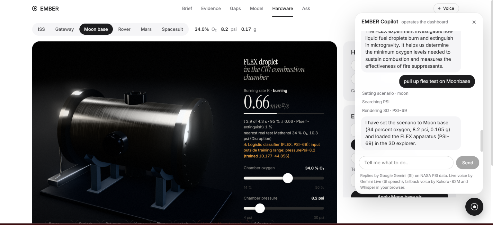
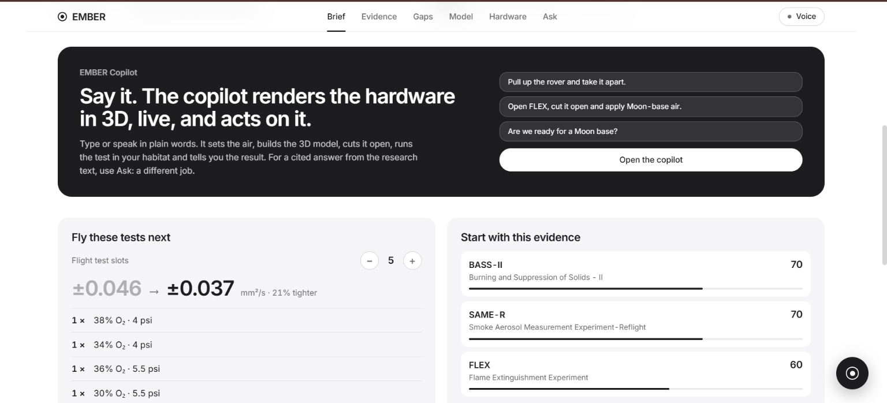
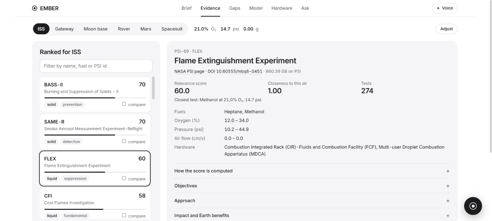
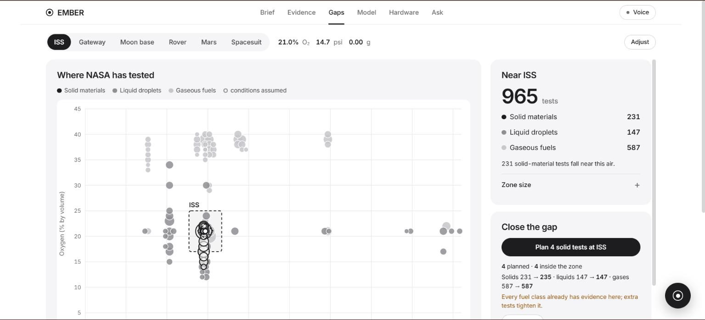
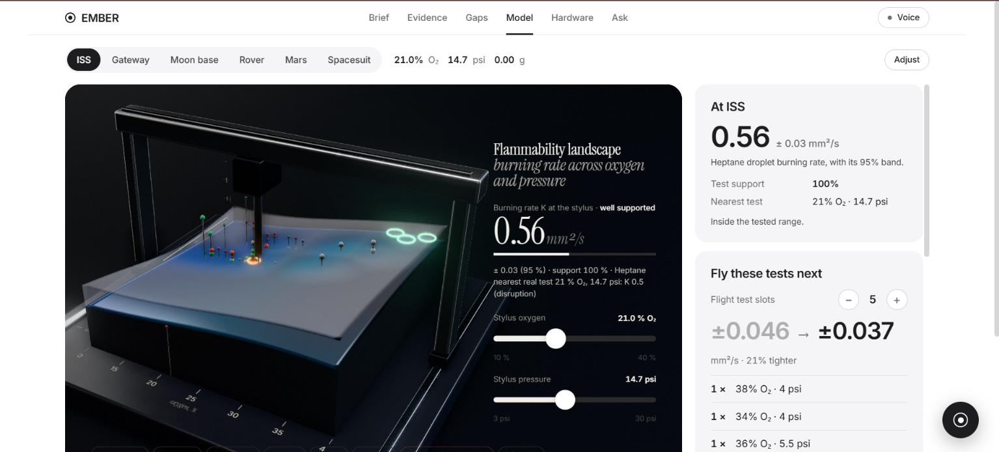
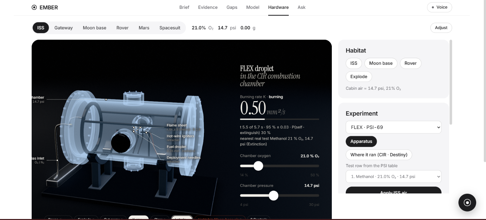
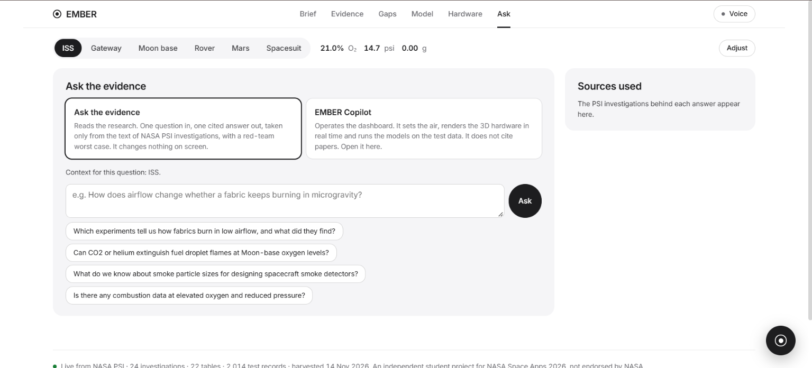

# EMBER: Evidence Map for Burning Environments in Reduced gravity

**NASA Space Apps Challenge 2026 · Flame in Freefall: SI-Powered Fire Safety Insights from Microgravity Combustion Data**
Team: Jayna Shirlie (solo)

EMBER turns NASA's microgravity combustion data (Physical Sciences Informatics, PSI) into fire-safety decisions for engineers designing crewed habitats on the Moon and Mars. For any habitat it says what the evidence supports, where it is missing, and which tests to fly next. Everything is computed from data harvested from NASA PSI. There are no mockups or hand-entered results.

**The finding:** of 1,735 NASA test conditions with oxygen and pressure, not one solid material (fabric or plastic) was burned above 22.2% O₂. Moon-base planning air is 34% O₂ at 8.2 psi.



## Why NASA's data needs a decision layer
PSI is an archive of experiments that each answered their own science question: 38 different outcome fields across 22 tables, no solid-material tests at habitat oxygen levels, and no tests in partial gravity. A bigger model cannot fix missing measurements. EMBER instead keeps a ledger of what is known, how well, and plans the next tests so each costly flight teaches the most.

## What it does
| View | What it shows |
|---|---|
| **Brief** | Five evidence checks per habitat (tests near this air, solid materials, recorded vs assumed conditions, gravity, model support), each Measured, Thin or Missing, with a verdict. Moon base: 2 of 5. |
| **Test-campaign optimizer** | Exact Gaussian-process experimental design: given N flight test slots, the atmospheres that shrink the model's 95% band the most across all habitats. |
| **Evidence** | All 24 PSI investigations ranked for the habitat by `100 × closeness × material × evidence`, with the formula shown, comparisons, DOIs and test rows. |
| **Gaps** | Every test plotted by oxygen and pressure, live counts inside the habitat zone, and a gap-closure planner. |
| **Model** | The burning-rate model as a 3D data sculpture: prediction, 95% band, every FLEX test, the next-best tests. Add your own tests and it retrains in the browser. |
| **Hardware** | Real-time 3D models built with physics solvers: FLEX, ACME, Saffire, the glovebox (BASS, SPICE), the ISS, a Moon base and a pressurized rover. Cut away, x-ray, explode, label, and "break it". |
| **EMBER Copilot** | Operates the dashboard by voice or text: sets the air, renders the 3D hardware live, runs the models. Real-time voice with Gemini Live, interruptible. |
| **Ask the evidence** | A different job: one question in, one cited answer out from PSI text, with a red-team worst case. |

| | |
|---|---|
|  |  |
|  |  |
|  |  |

## Machine learning (trained on NASA data, cross-validated)
| Model | Data | Result (5-fold CV) |
|---|---|---|
| Gaussian process: droplet burning rate | FLEX, PSI-69, 257 tests | R² 0.57, MAE 0.057 mm²/s, 94.6% of held-out tests inside the 95% band |
| Logistic classifier: hot-flame ignition | ACME CFI-G, PSI-159, 177 tests | AUC 0.74 |
| Logistic classifier: self-extinction | FLEX, 206 tests | AUC 0.82 |

## Run locally
```bash
pip install requests pandas numpy scikit-learn
python pipeline/harvest.py      # pull latest NASA PSI data
python pipeline/build.py        # build knowledge base + train models
cd web && npm install && npm run dev
```
Copy `.env.example` to `.env` and set `GEMINI_API_KEY` (used by the copilot, Ask and live voice).

## Deploy
Vercel: import the repo and set `GEMINI_API_KEY` (and optionally `GEMINI_MODEL`). `vercel.json` handles the build and the `/api/ask`, `/api/agent` and `/api/live` functions.

## NASA data
NASA PSI Combustion Science repository (CC0): https://psi.nasa.gov/physci/repo. Each investigation is cited by its PSI accession and DOI inside the app.

## Honest limits
- All PSI flight data is microgravity. There is no partial-gravity combustion data, so Moon and Mars results are bounded, not measured.
- PSI's solid-material tables don't record flame-spread rates, so the trained models cover liquid droplets and gas flames, not solids.
- Some tables omit pressure (BASS-II, Saffire, SAME); cabin pressure (14.7 psi) is assumed and flagged.
- The readiness thresholds in the Brief are EMBER's own judgement calls and are shown in the app.
- The Moon base and rover are concept designs; their sizes are EMBER assumptions. Habitat flame spread uses the de Ris thin-fuel formula with a no-dissociation flame temperature: an upper estimate.

## SI disclosure
- **In-app answers and voice:** generated by Google Gemini (Ask, Copilot, Gemini Live speech) and labelled as SI in the UI. Fallback speech uses the open-source Kokoro-82M (voice) and Whisper base.en (listening) models in the browser.
- **ML:** scikit-learn models trained by the author's pipeline on NASA data.
- **Concept and scope** decisions were made by the author. No NASA logos or insignia are used.

## References
NASA PSI; Ferkul et al., LPSC 2026 (LUCI/FM2); NASA NTRS flammability-limit and Saffire modelling reports; de Ris (1969) flame spread theory. Libraries and models: React, Vite, three.js, Machine Skill kit (MIT), scikit-learn, pandas, NumPy, requests, kokoro-js, Kokoro-82M (Apache-2.0), Transformers.js, Whisper base.en (MIT), Google Gemini API. Fonts: Inter, Instrument Serif, JetBrains Mono (OFL).

*EMBER is an independent project and is not endorsed by NASA.*
